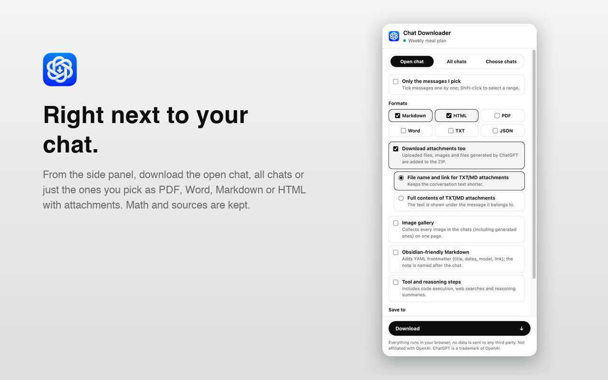

# Chat Downloader for ChatGPT

[Türkçe](README.tr.md)

A Chrome extension (Manifest V3) that saves your ChatGPT conversations to your own device as PDF, Word, Markdown, HTML, TXT or JSON, with attachments. It runs in the browser side panel and works entirely locally: no server, no analytics, no tracking.



> Not affiliated with, endorsed by or sponsored by OpenAI. "ChatGPT" is a trademark of OpenAI. The extension relies on ChatGPT's unofficial internal endpoints, which may change without notice.

## Features

- **Scope:** the open chat, all chats, or only the chats you pick, with search and project / no project / archived / GPT / date filters.
- **Message selection:** tick individual messages, Shift-click a range, or use "answers only" / "my prompts only".
- **Formats:**
  - PDF, made in the browser with the print dialog
  - Word (.docx)
  - Markdown
  - HTML in the ChatGPT look, with a searchable sidebar
  - TXT
  - JSON (the raw server data, all branches)
- **Attachments:** uploaded files, images and files generated by ChatGPT. `sandbox:` links are rewritten to point at the files in the ZIP.
- **Gallery:** a single page with every image, including generated ones.
- **Math and sources:** LaTeX is rendered with KaTeX (MathML) in HTML and PDF and kept as `$…$` in Markdown. Deep Research and web sources become footnotes, and Canvas documents are kept.
- **Obsidian mode:** YAML frontmatter, notes named after the chat, and saving straight into a folder (your vault) via the File System Access API.
- **Incremental backups:** only chats that changed since the last backup are exported.
- **Shared links:** works on `chatgpt.com/share/…`, with a fallback that reads the page when the API doesn't respond.
- **Shortcuts:**
  - a "Download" button next to ChatGPT's Share button
  - a right-click menu
  - Alt+Shift+D to open the panel
- **UI and progress:** live progress with cancel, automatic retries, light/dark theme, and 10 UI languages:
  - English
  - Türkçe
  - Deutsch
  - Español
  - Français
  - Italiano
  - Português (Brasil)
  - Русский
  - 日本語
  - 简体中文

## Install from source

1. Download or clone this repository.
2. Open `chrome://extensions` and turn on **Developer mode**.
3. Click **Load unpacked** and select the folder that contains `manifest.json`.

Requires Chrome 120 or later.

## Usage

1. Open a chat on chatgpt.com. The address must be `/c/…`, or a shared link `/share/…`.
2. Click the extension icon or press **Alt+Shift+D**. The side panel opens and stays open.
3. Pick a scope:
   - **Open chat:** optionally turn on **Only the messages I pick** to choose individual messages.
   - **All chats:** exported without attachments. With the gallery on, images are still included. Archived and project chats are included.
   - **Choose chats:** search and filter the list, then tick the chats you want.
4. Choose formats and options, then press **Download**. Progress shows in the panel and at the bottom right of the page, and **Cancel** stops it.

| Option | What it does |
|---|---|
| PDF | Opens the print dialog in a new tab; pick **Save as PDF**. Images are embedded. Several chats go into one PDF, each starting on a new page. |
| Word (.docx) | Headings, lists, tables, code, links and images. Math is written as LaTeX text. |
| Download attachments too | Adds uploaded files, images and files generated by ChatGPT to the ZIP. |
| Image gallery | Collects every image, including generated ones, in `gallery.html`. |
| Obsidian-friendly Markdown | YAML frontmatter (title, source link, dates, model, tags), and the note is named after the chat. |
| Tool and reasoning steps | Includes code execution, web searches and reasoning summaries. |
| Only chats that changed | Skips chats that haven't changed since the last backup (All / Choose scopes). |
| Save to: a folder | Writes into a folder you choose (for example an Obsidian vault) instead of a ZIP. Merges with earlier backups through `assets/archive.json`. Keep the side panel open while it runs. |

### Output

- A single chat in a single format without attachments downloads as one file.
- Otherwise you get a ZIP with:
  - `conversation.*`
  - `attachments/`
  - `gallery.html`
  - `download-report.json`
  - `README.txt`
- Bulk and folder exports use:
  - `chats/<date>-<title>-<id>/…`
  - `index.md` and `index.html`
  - `assets/chats.js`
  - `assets/archive.json` (folder mode)
  - `gallery.html`

### Limitations

- ChatGPT's internal endpoints may change. Projects are read from an unofficial endpoint and skipped silently if it fails. Compare the download report with the chat.
- The on-page "Download" button attaches to ChatGPT's "Share" button and may disappear if the UI changes. The context menu and side panel keep working.
- Expired or deleted attachments cannot be downloaded. ZIP files are limited to 4 GB (ZIP32) and by browser memory.

## Permissions

| Permission | Why |
|---|---|
| `sidePanel` | The UI lives in the side panel. |
| `scripting` | Runs the export code in the chatgpt.com tab when you start an export. |
| `storage` | Your settings, plus conversation IDs and update times for incremental backups. No conversation content is stored. |
| `contextMenus` | The right-click menu on chatgpt.com. |
| `https://chatgpt.com/*` | The only site the extension accesses. Also used for the optional on-page "Download" button. |

See [PRIVACY.md](PRIVACY.md) for the full privacy policy.

## Development

No build step or dependencies; the source is loaded as is. You need Node.js 22+ and Python 3.

```bash
node tools/locales.js   # generate _locales/*/messages.json (sources: tools/locales.js, tools/locales/*.js)
node tools/test.js      # unit/integration tests, no network needed (the Word check also runs macOS textutil)
tools/build.sh          # tests + Chrome Web Store ZIP in dist/
```

End-to-end tests load the real extension into headless Chrome against a mock chatgpt.com served over HTTPS:

```bash
openssl req -x509 -newkey rsa:2048 -nodes -keyout key.pem -out cert.pem -days 2 -subj "/CN=chatgpt.com" -addext "subjectAltName=DNS:chatgpt.com"
python3 tools/e2e/server.py 8765 /tmp/e2e cert.pem key.pem &
node tools/e2e/extension.js "/Applications/Google Chrome.app/Contents/MacOS/Google Chrome" /tmp/e2e
```

Set the same `E2E_LANG` (`en`, `tr`, `de`, `ja`…) on both commands to test another UI language.

Store images come from `tools/store-demo.js` and the e2e screenshots, put together by `tools/make-store-assets.py`. The Store listing copy is in [STORE_LISTING.md](STORE_LISTING.md).

### Project layout

| Path | What it holds |
|---|---|
| `src/core.js` | API client and export pipeline. |
| `src/render.js` | Markdown, HTML, TXT and print output. |
| `src/docx.js` | Word writer. |
| `src/zip.js` | ZIP writer. |
| `src/markdown.js` | Markdown parser. |
| `src/exporter.js` | Script injected into the page. |
| `src/background.js` | Service worker. |
| `src/page-button.js` | On-page "Download" button. |
| `sidepanel.*` | Side panel UI. |
| `print.*` | PDF print page. |

## License

[MIT](LICENSE). Bundles [KaTeX](https://katex.org) 0.19.0 (MIT, `vendor/KATEX-LICENSE.txt`).
