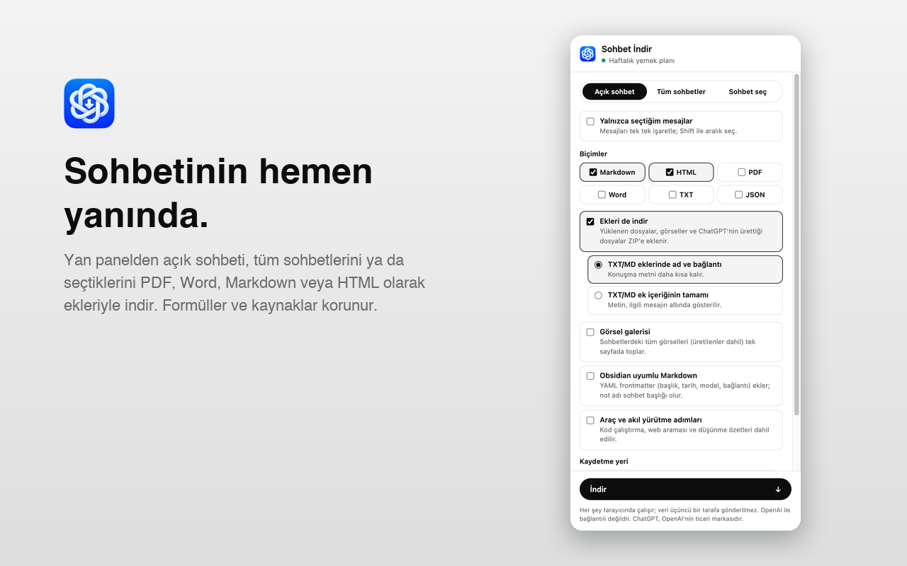

# ChatGPT için Sohbet İndir

[English](README.md)

ChatGPT sohbetlerinizi PDF, Word, Markdown, HTML, TXT veya JSON olarak, ekleriyle birlikte kendi cihazınıza kaydeden bir Chrome eklentisi (Manifest V3). Tarayıcının yan panelinde çalışır ve her şey yerelde olur: sunucu, analitik veya izleme yoktur.

> Eklenti OpenAI ile bağlantılı değildir; OpenAI tarafından onaylanmamış veya desteklenmemektedir. "ChatGPT", OpenAI'nin ticari markasıdır. Eklenti ChatGPT'nin resmî olmayan dahili uç noktalarını kullanır; bunlar haber verilmeden değişebilir.

## Kurulum (geliştirici modu)

1. Bu depoyu indirin veya klonlayın.
2. `chrome://extensions` adresini açın ve sağ üstten **Geliştirici modu**'nu açın.
3. **Paketlenmemiş öğe yükle**'ye tıklayın ve içinde `manifest.json` bulunan klasörü seçin.

Chrome 120 veya üstü gerekir.

## Kullanım

1. chatgpt.com'da bir sohbet açın. Adres `/c/…` ya da bir paylaşım bağlantısı (`/share/…`) olmalı.
2. Eklenti simgesine tıklayın veya **Alt+Shift+D**'ye basın. Yan panel açılır ve açık kalır.
3. Kapsamı seçin:
   - **Açık sohbet:** İsterseniz **Yalnızca seçtiğim mesajlar** ile mesajları tek tek işaretleyin.
     - Shift+tık bir aralığı seçer.
     - "Yalnızca cevaplar" ve "Yalnızca sorularım" kısayolları vardır.
   - **Tüm sohbetler:** Ekler indirilmez; galeri açıksa görseller yine eklenir. Arşivlenmiş ve proje sohbetleri dahildir.
   - **Sohbet seç:** Listede arayın. Proje / projesiz / arşivlenmiş / GPT ve tarih aralığı filtreleriyle süzüp istediklerinizi işaretleyin.
4. Biçimleri ve seçenekleri belirleyip **İndir**'e basın. İlerleme yan panelde ve sayfanın sağ altında görünür; **İptal** ile durdurabilirsiniz.

Yan panel dışında iki yol daha var:
- Sohbet başlığında **Paylaş** düğmesinin yanında bir **İndir** düğmesi bulunur. Son ayarlarla indirir; **Gelişmiş** bölümünden kapatılabilir.
- chatgpt.com'da sağ tık menüsünde üç komut bulunur: "Bu sohbeti indir", "Açık sohbeti indir" ve "Sohbet İndir panelini aç".

## Biçimler ve seçenekler

| Seçenek | Ne yapar |
|---|---|
| Markdown | Formüller `$…$` / `$$…$$` olarak, kaynaklar dipnot (`[^1]`) olarak yazılır. |
| HTML | ChatGPT görünümündedir. Formüller MathML ile çizilir, kod kopyalanabilir. Toplu dışa aktarmada `index.html` oluşturulur; sol panelde tüm sohbetler ve arama bulunur. |
| PDF | Yeni sekmede yazdırma penceresi açılır; hedef olarak **PDF olarak kaydet**'i seçin. Görseller gömülüdür, sunucu kullanılmaz. Birden çok sohbet tek PDF'e girer, her biri yeni sayfada başlar. |
| Word (.docx) | Başlıklar, listeler, tablolar, kod, bağlantılar ve görseller dahildir. Formüller LaTeX metni olarak yazılır. |
| TXT / JSON | TXT düz metindir. JSON, sunucunun ham verisidir ve tüm dalları içerir. |
| Ekleri de indir | Yüklenen dosyalar, görseller ve ChatGPT'nin ürettiği dosyalar eklenir. `sandbox:` bağlantıları ZIP'teki dosyaya çevrilir. |
| Görsel galerisi | Üretilenler dahil tüm görselleri `gallery.html` sayfasında toplar. |
| Obsidian uyumlu Markdown | YAML frontmatter ekler (başlık, kaynak bağlantısı, tarihler, model, etiket). Not adı sohbet başlığı olur. |
| Araç ve akıl yürütme adımları | Kod çalıştırma, web araması ve düşünme özetlerini ekler. |
| Yalnızca değişen sohbetler | "Tüm sohbetler" ve "Sohbet seç" kapsamında, son yedekten beri güncellenmeyen sohbetler atlanır. |
| Kaydetme yeri: Klasör | ZIP yerine seçtiğiniz klasöre (ör. Obsidian kasası) yazar. `assets/archive.json` ile önceki yedeklerle birleşir ve dizinleri günceller. İşlem sürerken yan panel açık kalmalı. |

Canvas belgeleri, Deep Research ve web kaynakları (dipnot olarak) ve üretilen görseller her biçimde korunur. Paylaşım bağlantılarında API yanıt vermezse ekrandaki mesajlar okunur; bu durumda yalnızca metin alınır.

## Çıktı yapısı

- **Tek dosya:** Tek sohbet, tek biçim seçilmiş ve ek yoksa yalnızca o dosya iner.
- **ZIP:** Diğer durumlarda bir ZIP iner. İçinde şunlar bulunur:
  - `conversation.*`
  - `attachments/`
  - `gallery.html`
  - `download-report.json`
  - `README.txt`
- **Toplu dışa aktarma ve klasöre kaydetme:**
  - `chats/<tarih>-<başlık>-<id>/…`
  - `index.md` ve `index.html`
  - `assets/chats.js`
  - `assets/archive.json` (yalnızca klasör modunda)
  - `gallery.html`

## Diller

Arayüz tarayıcı diline göre seçilir: Türkçe, English, Deutsch, Español, Français, Italiano, Português (Brasil), Русский, 日本語, 简体中文.

## Sınırlar

- ChatGPT'nin dahili uç noktaları değişebilir. Projeler resmî olmayan bir uç noktadan okunur; okunamazsa sessizce atlanır. İndirme raporunu sohbetle karşılaştırın.
- Sayfadaki "İndir" düğmesi ChatGPT'nin "Paylaş" düğmesinin yanına yerleşir; arayüz değişirse görünmeyebilir. Sağ tık menüsü ve yan panel çalışmaya devam eder.
- Süresi dolmuş veya silinmiş ekler indirilemez. ZIP dosyaları 4 GB (ZIP32) ve tarayıcı belleğiyle sınırlıdır.

## Gizlilik

Hiçbir veri toplanmaz. Eklenti yalnızca chatgpt.com'da çalışır ve tarayıcınızdan doğrudan chatgpt.com ile konuşur. Ayrıntılar: [PRIVACY.md](PRIVACY.md) (İngilizce).

## Geliştirme

Geliştirme belgeleri İngilizcedir: [README.md → Development](README.md#development).

## Lisans

[MIT](LICENSE). Pakette [KaTeX](https://katex.org) 0.19.0 bulunur (MIT, `vendor/KATEX-LICENSE.txt`).
